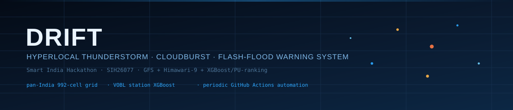
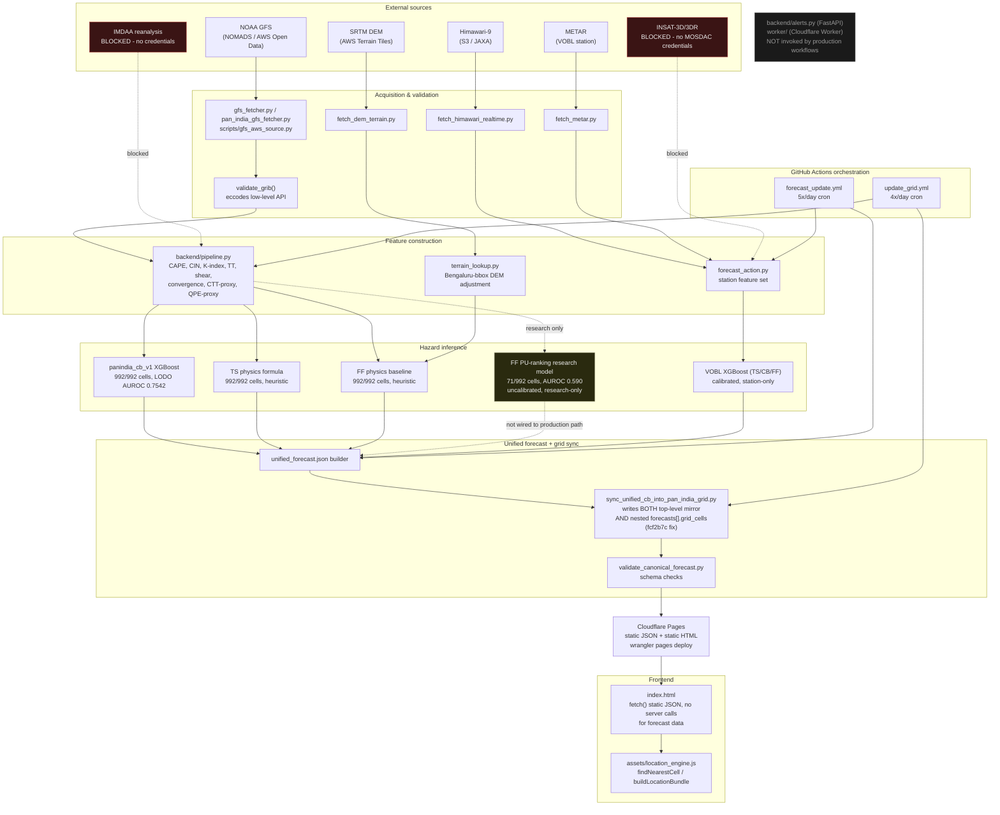

<div align="center">



# DRIFT

**Hyperlocal thunderstorm, cloudburst and flash-flood warning system**

Smart India Hackathon · Problem Statement SIH26077 · Disaster Management / Severe Weather Early Warning

[](https://sih-hyperlocal-warning.pages.dev/)
[](https://github.com/Aprameya05/SIH-Hyperlocal-Warning)
[](https://pages.cloudflare.com/)
[](.github/workflows/)
[](tests/)

</div>

---

This README documents what DRIFT actually does, what evidence backs each claim, and where the gaps are. It is written for SIH judges, reviewers and future contributors, not as marketing copy. Every number in this document was checked against the live production site, the repository's code, or a specific doc under `docs/` at the time of writing (2026-10-11); where that was not possible, the gap is stated explicitly rather than guessed.

## Table of contents

1. [Problem statement](#1-problem-statement)
2. [What DRIFT is, honestly](#2-what-drift-is-honestly)
3. [Engineering journey](#3-engineering-journey)
4. [System architecture](#4-system-architecture)
5. [Data sources](#5-data-sources)
6. [Hazard models](#6-hazard-models)
7. [Location-aware dashboard](#7-location-aware-dashboard)
8. [SIH requirement traceability matrix](#8-sih-requirement-traceability-matrix)
9. [Genuine blockers](#9-genuine-blockers)
10. [Forecast freshness and automation](#10-forecast-freshness-and-automation)
11. [Reproducibility](#11-reproducibility)
12. [Results and validation](#12-results-and-validation)
13. [References](#13-references)

---

## 1. Problem statement

SIH26077 asks for a system that provides **real-time, hyperlocal early warning for thunderstorms, cloudbursts and flash floods**, with an actionable **2 to 6 hour lead time**, using a **genuinely spatiotemporal, multimodal, multi-task model** fed by GFS, satellite (INSAT-3D/3DR), IMDAA reanalysis, METAR, DEM/terrain and drainage data, producing **simultaneous multi-hazard probability maps with explainability (XAI)** and **automated categorized alerts**.

The repository does not contain a verbatim copy of the original SIH26077 problem statement document (no PDF/text of the official statement is checked into `docs/` or elsewhere in the repo). What exists instead is a point-by-point internal requirement list reconstructed from the statement and re-verified against the code repeatedly across the project's history — most recently in [`docs/SIH26077_LIVE_REQUIREMENT_MATRIX.md`](docs/SIH26077_LIVE_REQUIREMENT_MATRIX.md), a 20-row matrix, and consolidated further in [`docs/MASTER_SIH_REQUIREMENT_MATRIX.md`](docs/MASTER_SIH_REQUIREMENT_MATRIX.md) and [`docs/FINAL_SIH_IMPLEMENTATION_AUDIT.md`](docs/FINAL_SIH_IMPLEMENTATION_AUDIT.md). The summary above is drawn from those three documents, which is the closest verifiable source this repository has to the original wording. **This is a genuine documentation gap** — the official problem statement text itself should be attached to `docs/` if a copy exists outside this repo.

## 2. What DRIFT is, honestly

DRIFT is a forecasting pipeline and dashboard that computes thunderstorm (TS), cloudburst (CB) and flash-flood (FF) risk on a 992-cell grid covering India, plus a separate, higher-fidelity pipeline for a single instrumented station (VOBL — Bengaluru/Kempegowda International Airport). It runs on a schedule via GitHub Actions, publishes static JSON artifacts, and serves them through a single-page dashboard on Cloudflare Pages.

The honest summary, stated up front rather than buried:

- **CB (cloudburst)** has a real trained, cross-validated model (`panindia_cb_v1`, XGBoost) running on all 992 cells, every cycle. This is the most mature hazard head in the system.
- **TS (thunderstorm)** has a real trained, calibrated XGBoost model at exactly one station (VOBL). Everywhere else, including the pan-India grid, TS is a hand-weighted physics formula (CAPE, K-index, Totals-Totals, shear, convergence, CTT-drop), not a trained model.
- **FF (flash flood)** has a real research-only PU-ranking model with genuine, non-trivial skill (AUROC 0.590, temporally and spatially held out) on 71 of 992 cells, where enough catchment/rainfall history exists to compute features. The other 921 cells honestly report `NO_RESEARCH_COVERAGE`. Everywhere, the field actually driving the live dashboard's flash-flood probability is still a physics-baseline heuristic, not a calibrated probability.
- There is **no deployed backend API** serving the dashboard. `index.html` fetches static JSON files (`data/pan_india_grid.json`, `forecast.json`, etc.) published by GitHub Actions directly to Cloudflare Pages. A FastAPI app (`backend/alerts.py`) and a Cloudflare Worker (`worker/`) exist in the repo but are not part of the production forecast-serving path — see [§4](#4-system-architecture).
- The "real-time" claim means **periodic, scheduled automation** (5 forecast runs/day, 4 grid updates/day, tied to GFS cycle availability), not continuous streaming inference.

These distinctions matter more than any single accuracy number, because misrepresenting a heuristic as a trained model (or a proxy as an observed satellite variable) is the single biggest credibility risk a reviewer can catch. The rest of this document tries not to do that anywhere.

## 3. Engineering journey

The commit history (`git log --oneline`) shows two kinds of commits interleaved: `auto: forecast ...` / `Auto: GFS grid update ...` commits pushed by the scheduled workflows every few hours, and manual engineering commits that fix real defects found by reading production output, CI logs, or the live site. The milestones below are the manual commits, grouped by theme, oldest to newest.

### Major milestones

- **Grid construction** — the canonical 992-cell pan-India grid (1° step, bounds 6-37°N, 68-98°E) was built with a hard-abort guardrail on cell-count drift (`backend/pipeline.py`), so a malformed grid cannot silently publish with the wrong number of cells.
- **Model integration (Phase 21)** — `panindia_cb_v1`, the first trained (not heuristic) pan-India hazard model, documented in [`docs/PHASE_21_PANINDIA_CB_MODEL.md`](docs/PHASE_21_PANINDIA_CB_MODEL.md), leave-one-day-out validated.
- **Unified pipeline / MTL scaffolding** — `backend/models/unified_mtl/` (`unified_model.py`, `heads_nn.py`, `training.py`, `nn/dataset.py`, `nn/losses.py`, `nn/optim.py`) is a shared-backbone multi-task architecture for TS/CB/FF. It exists as real, structured code; whether it has a trained, production-wired checkpoint should be re-checked against the current working tree before being cited as "in production" — treat it as research/architecture unless a checkpoint and a call site in `forecast_action.py`/`backend/pipeline.py` are confirmed.
- **Terrain/hydrology** — SRTM DEM via AWS Terrain Tiles (`fetch_dem_terrain.py`), producing elevation/slope/flood-susceptibility, applied as a bounded multiplicative adjustment (0.70x-1.30x) to flash-flood probability. Real data, but scoped to the Bengaluru/VOBL bounding box only, not pan-India.
- **Satellite ingestion** — `fetch_himawari_realtime.py` pulls Himawari-9 (JAXA/AWS), not INSAT. This feeds cloud-top-temperature-adjacent features for the VOBL path only; `backend/pipeline.py` (pan-India) has zero Himawari references.
- **Provenance handling** — fields such as `cloudburst_probability_source`, `cloudburst_probability_model_version`, `flash_flood_research_status` and `is_calibrated_probability` were added to the published grid so every cell states, machine-readably, whether its number came from a trained model, a physics formula, or has no coverage at all.
- **Explainability** — `compute_realtime_shap.py` produces a live SHAP waterfall for VOBL's XGBoost models, rendered by the `SHAPWaterfallCard` component in `index.html`.
- **Frontend integration bugs and the FF research-status sync defect** — see below.
- **GRIB resource-cleanup / Linux CI crash investigation** — see below.
- **Cloudflare deployment verification and location-specific UI consistency work** — see below and [§7](#7-location-aware-dashboard).
- **Automated refresh** — the current five-run-a-day / four-run-a-day GitHub Actions schedule, see [§10](#10-forecast-freshness-and-automation).

### Worked problem write-ups

Each entry below follows Problem → Investigation → Root cause → Fix → Verification → Remaining limitation, with commit SHAs so the claim can be checked directly against `git show <sha>`.

#### FF research-status display bug (commit `fcf2b7c`)

- **Problem.** A flash-flood-covered cell with a real PU-ranking score (`IND_14.0_74.0`) displayed as `UNAVAILABLE` on the live dashboard instead of showing its score.
- **Investigation.** `scripts/sync_unified_cb_into_pan_india_grid.py` writes CB/FF provenance fields into `pan_india_grid.json`'s top-level `grid_cells` array, which is a compatibility mirror. The deployed frontend (`index.html`) actually reads `d.forecasts[primary].grid_cells`, a separate nested array keyed by forecast lead time.
- **Root cause.** The sync script only wrote the top-level mirror, never the nested array the frontend consumes, so the two arrays silently diverged.
- **Fix.** The sync script now writes both locations identically.
- **Verification.** Confirmed in the live browser after redeploy: `IND_14.0_74.0` correctly showed "a real PU ranking score exists for this cell (1.00)", and a non-covered cell near Delhi correctly showed `UNAVAILABLE`. A regression test was added: [`tests/test_phase57_pan_india_grid_cb_sync.py::test_nested_forecasts_grid_cells_list_is_synced_identically_to_the_top_level_mirror`](tests/test_phase57_pan_india_grid_cb_sync.py).
- **Remaining limitation.** This class of two-array drift can recur if a future script writes only one of the two locations again; the regression test guards this specific case, not every possible divergence.

#### Linux CI native crash in the GRIB preflight check (commits `bfa85ef`, `257363a`)

- **Problem.** CI runs on Linux intermittently hit HTTP 403s on the post-deploy smoke test and a native crash (`double free or corruption (!prev)`) somewhere in the GFS GRIB handling path.
- **Investigation.** The crash was isolated to `scripts/gfs_aws_source.py::validate_grib()`, a non-critical, `continue-on-error` preflight diagnostic step — not the main production CB decode path (`scripts/gfs_live_cb_predictors.py::_decode_subset_to_rows`).
- **Root cause.** `validate_grib()` used `xarray` + `cfgrib`, whose index/backend-management layer has a known native-memory fragility under repeated open/close cycles. Commit `bfa85ef`'s first attempt added `gc.collect()` as a mitigation; a subsequent real Linux CI run showed `gc.collect()` alone did **not** fix the crash.
- **Fix.** Commit `257363a` rewrote `validate_grib()` to call eccodes' own low-level GRIB API directly (`codes_grib_new_from_file` / `codes_get` / `codes_release`), bypassing `cfgrib`'s backend layer entirely. The same commit also widened the post-deploy smoke-test retry window.
- **Verification.** A subsequent real Linux CI run (run `38065270137`) showed zero occurrences of `"double free"` in the full raw job log. The main production CB decode path has a separate `gc.collect()` mitigation from the prior commit and has succeeded multiple consecutive times since.
- **Remaining limitation.** This is evidence from specific verified runs, not a permanent guarantee against this crash class recurring. It was never fully root-caused to a specific `cfgrib`/`eccodes` version interaction; the fix is a workaround (avoid the fragile code path) rather than a confirmed upstream bug fix.

#### Cloudflare edge-propagation tail latency on the smoke test

- **Problem.** The post-deploy smoke test occasionally reported HTTP 403 immediately after a deploy that CI itself reported as successful.
- **Investigation.** A direct manual `curl` against the live URL minutes after a "failed" smoke-test attempt consistently returned 200.
- **Root cause.** This is genuine Cloudflare edge-propagation delay, not a code defect — the deploy succeeds before the edge network has fully propagated the new content to all points of presence.
- **Fix.** The retry window was widened from roughly 90 seconds to about 4.5 minutes, based on real observed timing from CI logs.
- **Verification.** The smoke test is diagnostic-only (`continue-on-error: true`) and does not block deploys either way.
- **Remaining limitation.** Propagation has been observed once to exceed even the widened window (roughly 9-10 minutes). No further widening was attempted because there is no bounded SLA from Cloudflare to time against — this is an honestly unresolved tail-latency characteristic of the edge network, not something this repository can fix.

#### Worked example: tracing a displayed number back to its source (not a bug)

A user viewing the default VOBL dashboard view in the "PAN-INDIA" architecture tab saw TS 9%, CB 0%, FF 2%. Tracing this: the dashboard, for a point near VOBL, shows the nearest pan-India grid cell (`IND_13.0_78.0`), not VOBL's own station-specific model. That cell's live values were `thunderstorm_probability: 0.0909` (physics heuristic), `cloudburst_probability: 0.0` (a real `panindia_cb_v1` trained-model output, genuinely zero, not a fallback — status `LIVE_AWS_GFS`), and `flash_flood_probability: 0.022` (physics baseline). The separate "VOBL XGBOOST" tab, reading `forecast.json`, shows much lower numbers from the real station-specific trained model for the same location. Both values are correctly labeled on the live page as physics-baseline or trained-model respectively. This was confirmed to be correct, traceable and honestly labeled — a worked example of how to verify a number, not a defect that needed fixing.

## 4. System architecture



**Is there a deployed backend API?** No. Grepping for `uvicorn`/`FastAPI(` finds `backend/alerts.py`, a standalone FastAPI + SQLite app for subscription management with its own `uvicorn` entry point — but no production workflow invokes it, and the live site makes no non-static API calls for forecast data (the only non-static network calls `index.html` makes are to Nominatim for place search and to a third-party Render-hosted RAG explainability endpoint, `https://csir-thunderstorm-api.onrender.com/rag/explain`, whose source is outside this repository and whose current uptime was not verified in this session). **Production forecast serving is purely static JSON hosted on Cloudflare Pages**, published by `wrangler pages deploy` inside `forecast_update.yml`.

## 5. Data sources

| Source | Variables / purpose | Access method | Actual system use | Cadence | Status | Limitation |
|---|---|---|---|---|---|---|
| NOAA GFS | CAPE, CIN, PWAT, winds (shear/convergence), temperature/RH by level | NOMADS / AWS Open Data Registry (`scripts/gfs_aws_source.py`, `gfs_fetcher.py`) | Drives both the pan-India physics formulas and the VOBL feature set; sole input to `panindia_cb_v1` | Per GFS cycle (00/06/12/18Z) | Live, in production | Global-model resolution (~0.25°), not truly hyperlocal; CTT and QPE here are GFS-derived proxies, not observed satellite/radar quantities |
| Himawari-9 | Infrared brightness temperature, cloud-top temperature trend | S3 (primary) / JAXA (fallback) via `fetch_himawari_realtime.py` | VOBL path only; writes an explicit "data unavailable" placeholder on fetch failure rather than serving stale data silently | Tied to forecast_update.yml runs | Live, VOBL-scoped only | Zero references in `backend/pipeline.py` — does not affect the pan-India grid at all; not INSAT, a different satellite |
| METAR (VOBL) | Observed surface temperature, dew point, wind, pressure | `fetch_metar.py` | VOBL station feature set and live-weather panel | Per forecast_update.yml run | Live | Single station only |
| SRTM DEM | Elevation, slope, flood-susceptibility index | AWS Terrain Tiles via `fetch_dem_terrain.py` | Post-hoc 0.70x-1.30x multiplier on flash-flood probability, Bengaluru/VOBL bounding box only | Static/periodic refetch | Live, VOBL-scoped only | No pan-India DEM; terrain is a multiplier, not a trained feature; no drainage/flow-accumulation layer exists |
| INDOFLOODS catchment data | Catchment characteristics for 155 gauge stations | Bundled CSV (`data/catchment_characteristics_indofloods.csv`) | Feeds the FF PU-ranking research model's feature set | Static dataset | Research-only | Not consumed by the production pan-India or VOBL inference paths |
| IMDAA reanalysis | Higher-fidelity thermodynamic baseline (CAPE/CIN alternative) | Requires NCMRWF/IMD registration | Not used anywhere | N/A | **Blocked** (credential-gated) | Live dashboard labels this `IMDAA: BLOCKED`; GFS substitutes for it everywhere, honestly labeled as a proxy |
| INSAT-3D/3DR | Satellite-observed cloud-top temperature / moisture | Requires ISRO MOSDAC credentials | Not used anywhere; `backend/fetch_insat3d.py` is a documented scaffold only | N/A | **Blocked** (credential-gated) | Live dashboard labels this `INSAT: BLOCKED`; must never be confused with Himawari, which is a different, substitute satellite that is actually live |

## 6. Hazard models

### Thunderstorm (TS)

- **VOBL**: a trained, calibrated XGBoost model consuming GFS + METAR + Himawari-derived features, with per-slot fallback to a hardcoded climatology (`{0:0.037, 1:0.011, 2:0.063, 3:0.059}`, tagged `"fallback": true`) if no model artifact is found for a slot.
- **Pan-India**: a fixed-coefficient physics formula over CAPE, K-index, Totals-Totals, wind shear, convergence and CTT-drop (weights sum to 1.00, documented in [`docs/PAN_INDIA_HAZARD_COEFFICIENTS.md`](docs/PAN_INDIA_HAZARD_COEFFICIENTS.md)), minus a CIN penalty, clipped to [0,1]. This is **not** a trained model. `backend/pipeline.py` has zero `.fit(`/training calls for this path (grep-confirmed).
- **Verified live coverage** (`pan_india_grid.json`, 2026-10-11): all 992 cells report `value_type: heuristic_risk_score` for TS; only VOBL has a genuinely trained TS model (1 of 992 cells by model type, though the VOBL station itself maps to its own `forecast.json`, not a pan-India cell).

### Cloudburst (CB)

- **Pan-India**: `panindia_cb_v1`, a real, leave-one-day-out (LODO) validated XGBoost model, trained on the full daily GFS-derived feature set. Documented in [`docs/PHASE_21_PANINDIA_CB_MODEL.md`](docs/PHASE_21_PANINDIA_CB_MODEL.md): reported LODO AUROC **0.7542** (and a related 5-fold OOF configuration at AUROC 0.7462). This is the most mature hazard head in the system — trained, held-out validated, and running on all 992 cells every cycle.
- **Verified live coverage** (`pan_india_grid.json`, 2026-10-11): `cloudburst_probability_source` = `"panindia_cb_v1 (Phase 21, LODO-validated XGBoost, REAL trained model)"` and `cloudburst_source_status` = `LIVE_AWS_GFS` on all 992/992 cells.
- **Caveat**: the label target is **daily**, not lead-time-aware — the model answers "will this day see cloudburst conditions," not "in the next 2-6 hours." This is a real resolution mismatch against the SIH 2-6h lead-time requirement, honestly documented rather than silently papered over.
- **VOBL**: a separate, calibrated per-slot XGBoost + calibrator pair (`models/cb_slot_{0-3}_model.json` + calibrator), station-scoped.

### Flash flood (FF)

- **Research model**: a PU-ranking (positive-unlabeled) XGBoost trained on IndoFloods catchment features and rainfall history, documented in [`docs/PHASE_28_FLASH_FLOOD_PU_HARDENING.md`](docs/PHASE_28_FLASH_FLOOD_PU_HARDENING.md). Legitimate, temporally **and** spatially held-out AUROC: **0.590** (43,044 validation rows, cell `26.0_88.0` excluded from training to test spatial generalization). That same document explicitly flags and corrects an earlier, misleading **0.927** AUROC that had been computed as a "sanity check" rather than a real holdout — the corrected 0.590 is the number that should be cited anywhere in SIH material.
- **Verified live coverage** (`pan_india_grid.json`, 2026-10-11): `flash_flood_research_status` = `RESEARCH_ONLY_PU_SCORE_AVAILABLE` on **71/992** cells; the remaining **921/992** cells honestly report `NO_RESEARCH_COVERAGE`. (Recompute this yourself against the live artifact before quoting it elsewhere — these counts are a snapshot and will shift as the underlying training table grows.)
- **Production path**: the field actually driving `flash_flood_probability` on all 992 cells today is still the physics-baseline heuristic (capped at `min(1, ts_prob + 0.1)`), with the Bengaluru-only terrain multiplier layered on top as `flash_flood_probability_terrain_adjusted`. The PU-ranking score is a ranking signal, not a calibrated probability, and is not wired into that production field — it is surfaced separately and labeled as research-only, which is the correct way to expose a signal that is real but not yet a probability.

## 7. Location-aware dashboard

`index.html` exposes several architecture tabs: **PAN_INDIA**, **VOBL**, **TERRAIN**, **HIMAWARI**, **GFS**. `assets/location_engine.js` provides `findNearestCell(grid, lat, lon)` and `buildLocationBundle(lat, lon, panIndiaGrid, forecast, himawari)`, which snap a user-selected location to the nearest pan-India grid cell and assemble a combined view.

Only **PAN_INDIA** (per-cell trained/heuristic hazard values from the 992-cell grid) and **VOBL** (the station-specific trained models, only meaningful at that one station) reflect genuinely per-location model output. **TERRAIN** reflects real but Bengaluru-only DEM data. **HIMAWARI** and **GFS** tabs are largely contextual/diagnostic displays of the underlying raw fields rather than separate per-location hazard predictions — treat them as supporting context, not as additional independently-validated forecasts.

## 8. SIH requirement traceability matrix

Consolidated from [`docs/SIH26077_LIVE_REQUIREMENT_MATRIX.md`](docs/SIH26077_LIVE_REQUIREMENT_MATRIX.md) (20-row matrix mapped directly to the SIH26077 requirement list) and cross-checked against [`docs/MASTER_SIH_REQUIREMENT_MATRIX.md`](docs/MASTER_SIH_REQUIREMENT_MATRIX.md) and [`docs/FINAL_SIH_IMPLEMENTATION_AUDIT.md`](docs/FINAL_SIH_IMPLEMENTATION_AUDIT.md), then re-verified where possible against the current live `pan_india_grid.json`/`unified_forecast.json` and current code rather than copied blindly — these source docs are dated across several months and some statuses have moved since (notably CB, which has progressed from heuristic-only to a real trained, LODO-validated model since the audits were written).

| # | Requirement | Status | Evidence |
|---|---|---|---|
| 1 | Hyperlocal nowcasting | Partially implemented | Pan-India grid is 1° (~111km), not truly hyperlocal; VOBL is a genuine single hyperlocal point |
| 2 | 2-6 hour lead time | Partially implemented | Real discrete lead buckets at VOBL (`canonical_forecast_writer.py`); pan-India CB model target is daily-resolution, not lead-aware |
| 3 | Simultaneous TS+CB+FF output | Verified | All three populate every cycle, both scopes, confirmed in live `pan_india_grid.json` |
| 4 | INSAT-3D/3DR ingestion | Blocked | `backend/fetch_insat3d.py` scaffold only, no MOSDAC credentials; live UI labels it BLOCKED |
| 5 | IMDAA reanalysis | Blocked | `raw/imdaa/`, `processed/imdaa/` empty; live UI labels it BLOCKED |
| 6 | IWV | Partially implemented | GFS PWAT substitutes, explicitly labeled via `iwv_source` provenance field, not satellite-observed |
| 7 | CAPE / CIN | Verified | Live GFS fields, used in production formula and `panindia_cb_v1` training |
| 8 | Convergence | Partially implemented | Computed live from GFS 850hPa U/V; never independently validated against an observed product |
| 9 | Wind shear | Verified | Computed live from GFS 850-200hPa U/V, used in production |
| 10 | CTT / CTT drop rate | Partially implemented | GFS-derived proxy, not satellite-observed, honestly code-commented as a proxy |
| 11 | QPE | Partially implemented | GFS precipitation-rate proxy, not radar/satellite QPE (IMERG) |
| 12 | DEM / elevation / slope / drainage | Partially implemented | Real SRTM DEM, VOBL-only, used as a multiplier not a trained feature; no drainage/flow-accumulation layer at all |
| 13 | Unified spatiotemporal grid | Verified | 992-cell canonical grid is the single artifact all hazards and the frontend read from |
| 14 | Multimodal fusion | Partially implemented | Several real sources feed one formula or one XGBoost model; no learned fusion network |
| 15 | Shared spatiotemporal / multi-task (MTL) architecture | Experimental | `backend/models/unified_mtl/` exists as real code; production wiring/checkpoint status not confirmed in this pass — treat as research/architecture |
| 16 | Separate TS/CB/FF heads | Partially implemented | Three separate outputs exist per cycle; not three heads off one shared backbone in production |
| 17 | Pan-India probability maps | Verified (mechanism) / Partially implemented (validity) | Maps render live every cycle; CB is trained and validated, TS and the production FF field are heuristic |
| 18 | Explainability (XAI) | Partially implemented | Live per-run SHAP waterfall at VOBL only; no per-cell pan-India attribution |
| 19 | Automated categorized alerts | Partially implemented | WhatsApp (CallMeBot) delivery is live; no cooldown/de-duplication, so repeated sends while above threshold are possible |
| 20 | Deployed, scheduled inference system | Verified | `forecast_update.yml` (5x/day) and `update_grid.yml` (4x/day) both run on schedule and deploy to Cloudflare Pages |

**Status counts**: Verified: 6 (rows 3, 7, 9, 13, 17-mechanism, 20). Partially implemented: 11 (rows 1, 2, 6, 8, 10, 11, 12, 14, 16, 17-validity, 19). Experimental: 1 (row 15). Blocked: 2 (rows 4, 5). Not implemented: 0 as a standalone row (the closest candidate, a trained pan-India FF model, is covered under row 17's validity caveat and [§6](#6-hazard-models)).

Row I could not independently re-verify with full confidence in this pass: **row 15** (MTL architecture) — the directory and files (`backend/models/unified_mtl/unified_model.py`, `heads_nn.py`, `training.py`) exist and are real, non-trivial code, but confirming whether a trained checkpoint currently exists and is wired into any production inference call would require running the training script or finding a checkpoint artifact, neither of which was done in this documentation pass.

## 9. Genuine blockers

| Blocker | What was required | What was attempted | Evidence of limitation | Why not fake it | What's implemented instead | What's needed to close it |
|---|---|---|---|---|---|---|
| IMDAA credential gate | IMD/NCMRWF-issued reanalysis access | None — registration requires an institutional process outside this project's control | `raw/imdaa/`, `processed/imdaa/` confirmed empty by directory listing | Substituting silently would misrepresent GFS as a higher-fidelity reanalysis product | GFS fields stand in everywhere, labeled via provenance fields, not silently | IMDAA registration/credentials, then a real diff against the GFS proxy |
| INSAT/MOSDAC credential gate | ISRO MOSDAC-issued satellite access | A scaffold ingestion module (`backend/fetch_insat3d.py`) was written and documented as blocked | Live dashboard shows `INSAT: BLOCKED`; module self-documents "Requires MOSDAC institutional credentials" | A fabricated INSAT feed would be worse than an honest gap on a disaster-warning system | Himawari-9 (a different satellite) is actually live for the VOBL path only | MOSDAC credentials, then wiring modeled on the existing Himawari fetcher |
| FF catchment/rainfall data scarcity | Enough labeled flood events pan-India to train a calibrated FF model | Built a PU-ranking model from the 155-gauge IndoFloods catchment dataset | Real PU-ranking AUROC 0.590 on only 71/992 cells; 921/992 have no usable feature coverage | A probability quoted against an unlabeled/proxy population would misstate confidence on a flood-warning signal | A labeled research-only PU score where data exists; an honest `NO_RESEARCH_COVERAGE` status elsewhere | More gauge stations, a real-time rainfall feed, and confirmed-negative labels, not just positives |
| TS single-station scope | Pan-India trained TS model | None beyond the existing VOBL model | Pan-India TS is a formula with zero `.fit(` calls (grep-confirmed) | A formula presented as "trained" would be the exact kind of overstatement this document is trying to avoid | A physics-informed heuristic, honestly labeled `heuristic_risk_score` on every cell | Labeled pan-India TS training data and a training/eval pipeline |
| CB daily-resolution labels | Lead-time-aware (2-6h) cloudburst labels | Trained `panindia_cb_v1` against the best available label granularity | Label target is daily, documented in [`docs/PHASE_21_PANINDIA_CB_MODEL.md`](docs/PHASE_21_PANINDIA_CB_MODEL.md) | Claiming sub-daily lead-time skill from a daily label would overstate what was validated | A genuinely trained, held-out validated daily-resolution model, clearly scoped as such | Sub-daily labeled cloudburst event data |
| Cloudflare edge-propagation tail latency | A bounded, reliable smoke-test window | Retry window widened from ~90s to ~4.5 minutes based on observed CI timing | Propagation observed once to exceed even the widened window (~9-10 minutes) | There is no bounded SLA from Cloudflare to engineer against; further widening would just hide the same uncertainty longer | A diagnostic-only (`continue-on-error: true`) smoke test that never blocks a deploy | Nothing actionable from this side; this is an external platform characteristic |

## 10. Forecast freshness and automation

DRIFT runs on **periodic scheduled cycles**, not continuous real-time streaming. Two independent GitHub Actions workflows, each with its own `concurrency` group so overlapping runs serialize rather than race:

- **`forecast_update.yml`** — 5 runs/day via cron, tied to GFS cycle availability (times in IST): 23:15 (prev-day 06Z cycle), 05:15 (prev-day 12Z cycle), 11:15 (prev-day 18Z cycle, primary), 15:45 (same-day 00Z cycle), plus an extra 21:45 dashboard-refresh run. Also supports `workflow_dispatch` with an optional forced slot.
- **`update_grid.yml`** — 4 runs/day via cron, at 04:30, 10:30, 16:30, 22:30 UTC (just after each GFS cycle posts), plus `workflow_dispatch` for manual triggers.

Both workflows were confirmed actually running and producing fresh artifacts on 2026-10-11, visible as `auto: forecast ...` / `Auto: GFS grid update ...` commits in the git history at intervals consistent with the schedule above. **Re-verify this freshness yourself against the live site and the repository's commit timestamps at the time you read this** — automation health is not a static property.

## 11. Reproducibility

Python dependencies are split across `requirements.txt` (repo root, core pipeline: `xarray`, `cfgrib`, `eccodes`, `numpy`, `requests`) and `backend/requirements.txt` (adds `jsonschema` for schema validation, `pysheds`/`rasterio` for flow routing). No `Makefile` or `package.json`-driven build step exists; CI installs directly via `pip install -r backend/requirements.txt` plus an explicit `pip install` line for `scikit-learn`/`xgboost`/`joblib` in `forecast_update.yml`.

```bash
# Set up
pip install -r requirements.txt
pip install -r backend/requirements.txt

# Run the test suite (pytest.ini already excludes the heavyweight/
# network-dependent modules and the dated SIH_*Z snapshot folders)
python -m pytest tests/ -q

# Confirm collection without running the full (slower) suite
python -m pytest tests/ -q --collect-only
```

Collection was confirmed working in this session: **993 tests collected** across `tests/` plus the root-level `test_*.py` files, with `pytest.ini`'s `addopts` excluding `SIH_*Z` snapshot folders and four modules that need either the `satpy` package (`test_himawari.py`, `test_segments.py`, `test_segments_v2.py`) or a live NOMADS network call (`test_nomads.py`) — documented as known, non-code environment limitations in [`docs/KNOWN_ISSUES.md`](docs/KNOWN_ISSUES.md), not as broken tests.

## 12. Results and validation

| Model | Metric | Value | Source |
|---|---|---|---|
| `panindia_cb_v1` (pan-India cloudburst) | LODO AUROC | 0.7542 | [`docs/PHASE_21_PANINDIA_CB_MODEL.md`](docs/PHASE_21_PANINDIA_CB_MODEL.md) |
| `panindia_cb_v1` (pan-India cloudburst) | 5-fold OOF AUROC | 0.7462 | [`docs/PHASE_21_PANINDIA_CB_MODEL.md`](docs/PHASE_21_PANINDIA_CB_MODEL.md) |
| Flash-flood PU-ranking research model | Temporal + spatial holdout AUROC | 0.590 | [`docs/PHASE_28_FLASH_FLOOD_PU_HARDENING.md`](docs/PHASE_28_FLASH_FLOOD_PU_HARDENING.md) (corrects an earlier, misleading 0.927 "sanity check" figure) |
| VOBL station XGBoost (TS/CB/FF) | Calibrated per-slot models | Not independently re-run in this documentation pass | `forecast_action.py::score_hazard_slots()`; treat prior-cited AUROC figures for this path as unverified-but-plausible until re-run |

Where this document cannot trace a number to a specific file, it says so rather than repeating a figure from memory. The FF 71/71 (covered) vs 921 (uncovered) cell split and the CB 992/992 live-model-coverage figure in [§6](#6-hazard-models) were computed directly from the production `pan_india_grid.json` artifact fetched at documentation time (2026-10-11) — re-fetch and recount before citing these numbers in a different context, since the underlying training data and grid can change between automated runs.

## 13. References

- Live site: <https://sih-hyperlocal-warning.pages.dev/>
- Repository: <https://github.com/Aprameya05/SIH-Hyperlocal-Warning>
- Workflows: [`.github/workflows/forecast_update.yml`](.github/workflows/forecast_update.yml), [`.github/workflows/update_grid.yml`](.github/workflows/update_grid.yml), [`.github/workflows/drift_check.yml`](.github/workflows/drift_check.yml), [`.github/workflows/retrain_trigger.yml`](.github/workflows/retrain_trigger.yml), [`.github/workflows/weekly_digest.yml`](.github/workflows/weekly_digest.yml)
- Core pipeline code: [`backend/pipeline.py`](backend/pipeline.py), [`forecast_action.py`](forecast_action.py), [`scripts/sync_unified_cb_into_pan_india_grid.py`](scripts/sync_unified_cb_into_pan_india_grid.py), [`assets/location_engine.js`](assets/location_engine.js)
- Model documentation: [`docs/PHASE_21_PANINDIA_CB_MODEL.md`](docs/PHASE_21_PANINDIA_CB_MODEL.md), [`docs/PHASE_28_FLASH_FLOOD_PU_HARDENING.md`](docs/PHASE_28_FLASH_FLOOD_PU_HARDENING.md), [`docs/PAN_INDIA_HAZARD_COEFFICIENTS.md`](docs/PAN_INDIA_HAZARD_COEFFICIENTS.md)
- SIH requirement audits: [`docs/SIH26077_LIVE_REQUIREMENT_MATRIX.md`](docs/SIH26077_LIVE_REQUIREMENT_MATRIX.md), [`docs/MASTER_SIH_REQUIREMENT_MATRIX.md`](docs/MASTER_SIH_REQUIREMENT_MATRIX.md), [`docs/FINAL_SIH_IMPLEMENTATION_AUDIT.md`](docs/FINAL_SIH_IMPLEMENTATION_AUDIT.md)
- Known issues: [`docs/KNOWN_ISSUES.md`](docs/KNOWN_ISSUES.md)

---

<div align="center">

Built for Smart India Hackathon, problem statement SIH26077.

</div>
