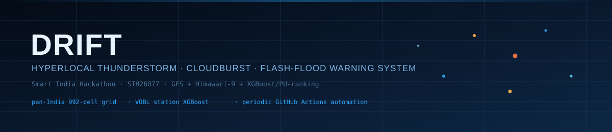

<div align="center">



# DRIFT

**Pan-India, location-aware early-warning decision support for severe thunderstorms, extreme rainfall and flash-flood risk**

Smart India Hackathon · SIH26077 · [Live site](https://sih-hyperlocal-warning.pages.dev/)

</div>

---

DRIFT turns NOAA GFS model guidance into a verified, location-specific view for **4,643 land cells (0.25°) across India**, adds trained and calibrated hazard probabilities **only where a model has been validated**, and says "unavailable" everywhere else. Every value carries provenance and timestamps, and its freshness status is recomputed from the clock rather than trusted from the producer.

## What works today (and what does not)

| Capability | Status |
|---|---|
| National grid: 4,643 land cells, state/district per cell, 3,756-place gazetteer, search by name or coordinate | **Working**, independently checked against raw GRIB for 27 diverse locations ([report](docs/NATIONAL_COVERAGE_AND_LOCATION_TESTS.md)) |
| GFS fields and derived physics (K-index, Total Totals, lapse rate, 850–500 hPa shear, convergence, PWAT gradient) | **Working**, refreshed twice daily |
| Thunderstorm probability, +6/12/18/24 h | **Working in season only: published for Apr–Jun cycles, `unavailable` otherwise** (validated on Apr–Jun 2024/2025 only) (2024/2025, 113 METAR stations); calibrated XGBoost + TreeSHAP; target is *ordinary* thunderstorm (METAR TS/VCTS); these are NWP forecast hours, not a nowcast |
| Bengaluru (VOBL) station thunderstorm slots | **Fallback-flagged**: 20 of 64 model inputs (station observations) have no live source and are fixed constants, so these slots never drive an alert; SHAP excludes the constants. Station cloudburst/flash-flood scores are **withheld** (training-label leakage) |
| Heavy rainfall: ≥20 mm / 3 h at forecast hour 9 | **Working in season only: 00Z cycles in Jun–Sep (monsoon), `unavailable` otherwise**; one target only |
| Cloudburst prediction | **Unavailable** (no sub-hourly labels or observations). The only related output is a daily *heavy-rain-day* score (≥ 64.5 mm/24 h), which is not a cloudburst forecast |
| Flash-flood prediction | **Unavailable**; an unvalidated heuristic *screening index* is shown, labelled as such |
| 2–6 h operational lead time, nowcasting | **Lead is measured, a 2–6 h warning is not claimed.** The panel shows each hour's *operational lead* = valid time minus the time DRIFT acquired that NWP file (excludes dissemination to users; never negative). For a 00Z cycle acquired ~5 h after init, only f009 falls in 2–6 h, and no hazard model exists at that hour. Alerts stay disabled. See [`docs/research/SATELLITE_AND_LEAD_TIME_FEASIBILITY.md`](docs/research/SATELLITE_AND_LEAD_TIME_FEASIBILITY.md) |
| Satellite (INSAT/MOSDAC, Himawari), IMDAA, radar, lightning | **Not integrated**; blockers in [`docs/data_sources/SATELLITE_AND_REANALYSIS_ACCESS.md`](docs/data_sources/SATELLITE_AND_REANALYSIS_ACCESS.md) |
| Alert delivery | **Disabled by design** (fail-closed policy, empty registries) |
| LIVE vs SIMULATION | Strictly separated; the simulator has no network capability and cannot alert |

Validation numbers (confidence intervals, calibration, baselines, per-lead, leave-one-region-out) are generated from the evaluation files into [`docs/HAZARD_MODEL_VALIDATION.md`](docs/HAZARD_MODEL_VALIDATION.md); nothing is typed by hand. Limits: [`docs/OPERATIONAL_LIMITATIONS.md`](docs/OPERATIONAL_LIMITATIONS.md).

## Architecture

```
NOAA GFS 0.25° (AWS S3, byte-range) ──► pipelines/ingestion ──► data/india_fields_latest.json
                                              │  (eccodes decode, cross-checked headers, S3 Last-Modified = input publication time,
                                              │   atomic write, no-downgrade guard, data/ingest_status.json)
                                              ▼
              models/thunderstorm, models/extreme_rainfall ──► data/india_{ts,rain}_model_latest.json
                                              │
                          backend/ (location service, /v1 API, alert policy)
                                              │
        pipelines/validation (release gate) ─► pipelines/publishing (allow-list bundle) ─► Cloudflare Pages
                                              ▼
                      frontend/ (static command centre; JS twin of the verifier and location engine)
```

The production site is **static**: the browser loads committed JSON artifacts and re-verifies them. The FastAPI `/v1` service (`backend/location_api.py`) implements the same logic for server use but is not part of the deployed path. Details: [`docs/FINAL_SYSTEM_ARCHITECTURE.md`](docs/FINAL_SYSTEM_ARCHITECTURE.md).

## Quick start

Requires Python ≥ 3.11 and Node ≥ 20 (Node and Chrome are only needed for browser tests).

```bash
git clone https://github.com/Aprameya05/SIH-Hyperlocal-Warning.git && cd SIH-Hyperlocal-Warning
python3 -m venv .venv && source .venv/bin/activate
make install            # pip install -r requirements/dev.txt
cp .env.example .env    # optional; every value is a placeholder
make test               # Python suite
make gate               # build the bundle and run the release-readiness gate
make serve              # http://localhost:8000/drift.html
```

Refresh data (network): `make ingest && make predict`. Browser tests: `cd tests/e2e && npm ci && npm test` (uses system Chrome; set `CHROME_PATH` if needed). Full list: `make help`.

Tests run on Linux in CI (`.github/workflows/tests.yml`: full suite on every pull request and push to `main`, plus the Worker's `node:test` security suite). A fresh checkout passes with no failures; about 51 tests skip, each with an explicit reason (raw GRIB2 files, `ts_labels.csv` and other git-ignored research inputs are not in the repository). Run `python -m pytest -rs` to list them. Set `PYTHONUTF8=1` on Windows.

## API (`backend/location_api.py`, prefix `/v1`)

`/meta`, `/search`, `/resolve`, `/location`, `/region`, `/compare`, `/coverage`, `/forecast`, `/explain`, `/health`, `/ready`, `/alert-eligibility`. The module exposes a FastAPI `router`; mount it with `app.include_router(router)` (this is how `tests/test_location_api.py` exercises it). It is not deployed in production.

## Repository map

| Path | Contents |
|---|---|
| `frontend/` | Static UI (`drift.html`, `assets/`); published at the bundle root |
| `backend/` | Location service, `/v1` API, alert policy, data-source adapters, feature builder |
| `pipelines/ingestion` · `feature_engineering` · `publishing` · `validation` | GFS ingestion; training-table builders; allow-list bundle builder; validators and release gate |
| `models/thunderstorm`, `models/extreme_rainfall`, … | Training, evaluation, prediction code and artifacts per hazard |
| `tests/` | Python tests (flat), JS tests (`*.mjs`), `tests/e2e` (Playwright) |
| `scripts/utilities`, `scripts/diagnostics` | Generated docs, acceptance run, inventory |
| `data/`, `processed/`, `imd_rain/` | Generated artifacts and datasets |
| `worker/` | Cloudflare Worker for alert subscriptions (not in the forecast-serving path; deploys manually and **requires a `TOKEN_SECRET` secret**, it refuses to run without one; `ADMIN_KEY` guards the subscriber list; per-client KV rate limits on `/subscribe` and `/unsubscribe`; run `python scripts/check_worker_config.py --remote` before deploying) |
| `docs/` | Architecture, data sources, models, evaluation, operations, security, demo, archive |
| `research/legacy_experiments/` | Archived experiments |
| `.github/workflows/` | `tests.yml` (Linux suite), `india_fields.yml` (GFS ingest and models), `forecast_update.yml` (forecast artifacts, the allow-list bundle and the Wrangler Pages deploy) and `update_grid.yml` (hazard grid artifacts), `drift_check.yml`, `retrain_trigger.yml`, `weekly_digest.yml`; commits are fast-forward only and the forecast, grid, drift, retrain and digest workflows share one concurrency lock (`india_fields` has its own) |

Root-level modules (`forecast_action.py`, `send_alerts.py`, `regrid.py`, …) belong to the older station/992-cell pipeline that workflows import by path; see [`docs/architecture/REPOSITORY_STRUCTURE.md`](docs/architecture/REPOSITORY_STRUCTURE.md).

## Documentation index

[Architecture](docs/FINAL_SYSTEM_ARCHITECTURE.md) · [Data sources & provenance](docs/DATA_SOURCE_AND_PROVENANCE_MATRIX.md) · [Hazard model validation](docs/HAZARD_MODEL_VALIDATION.md) · [National coverage tests](docs/NATIONAL_COVERAGE_AND_LOCATION_TESTS.md) · [Lead-time validation](docs/FORECAST_LEAD_TIME_VALIDATION.md) · [Limitations](docs/OPERATIONAL_LIMITATIONS.md) · [SIH traceability (evidence-checked)](docs/SIH_TRACEABILITY.md) (supersedes the earlier [requirement list](docs/FINAL_SIH_REQUIREMENT_TRACEABILITY.md)) · [Demo runbook](docs/DEMO_RUNBOOK.md) · [Verification report](docs/FINAL_VERIFICATION_REPORT.md) · [National data report](docs/data_sources/NATIONAL_DATA_REPORT.md)

The previous long-form README (engineering history, pre-national-grid) is archived at [`docs/archive/reports/README_legacy_20261011.md`](docs/archive/reports/README_legacy_20261011.md); its numbers (992-cell grid, 993 tests) are superseded.

## Contributing

See [CONTRIBUTING.md](CONTRIBUTING.md). Never fabricate data, probabilities or lead times; missing is `null`/unavailable.
